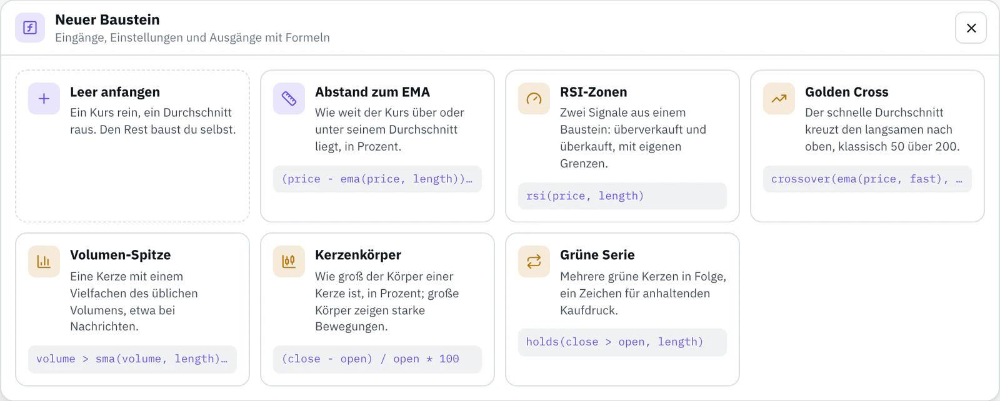

# Einen Baustein beitragen

Danke, dass du einen Baustein teilst. Diese Anleitung führt von der Idee bis zum gemergten Pull Request. In English: [CONTRIBUTING.md](CONTRIBUTING.md)

## Was einen guten Baustein ausmacht

- **Eine klare Aufgabe:** ein Wert oder Signal, das sich aus den vorhandenen Bausteinen nicht so leicht bauen lässt, unter `help` mit Beispiel erklärt.
- **Lesbare Formeln:** gute Namen für Eingänge und Einstellungen, frühere Ausgänge weiterverwenden statt wiederholen.
- **Sinnvolle Einstellungen:** jede Länge mit Mindest- und Höchstwert; Standardwerte, die auf Stundenkerzen funktionieren.
- **Geprüfte Zahlen:** Tests mit Referenzwerten, die du unabhängig bestimmt hast (unten).
- **Beide Sprachen:** Name und Beschreibung auf Deutsch und Englisch. Kein Englisch? Schreib Deutsch in beide und sag es im Pull Request; wir übersetzen.

## Schritt für Schritt

### 1. Im Editor bauen

Öffne den [Editor](https://app.bellchain.app/), ohne Konto. In der Bausteinleiste unter **Eigene Bausteine** auf **Neuer Baustein** klicken. Mit einem Beispiel anfangen oder leer. Fehler stehen direkt am Feld, und der Probelauf rechnet jeden Ausgang über 500 Stunden BTC/USDT.



### 2. Exportieren

**Exportieren** unten links im Dialog speichert den Baustein als `<name>.bellchain-node.json`. Der Reiter **JSON** zeigt denselben Text.

### 3. Forken und Datei anlegen

Im Browser:

1. Oben rechts auf dieser Seite **Fork** klicken.
2. In deinem Fork: **Add file** → **Upload files**, die Datei nach `community/` ziehen und `community/<name>.json` nennen: Kleinbuchstaben, Ziffern und Bindestriche.
3. **Commit changes** auf einem neuen Branch.

Die `id` in der Datei ist `custom.<name>`, etwa `custom.hull-trend` in `community/hull-trend.json`.

Mit git:

```bash
git clone https://github.com/<dein-name>/nodes
cd nodes
git switch -c hull-trend
cp ~/Downloads/hull-trend.bellchain-node.json community/hull-trend.json
```

### 4. Datei vervollständigen

| Feld | Regel |
|---|---|
| `label`, `description` | In `de` und `en`. Die Beschreibung passt in eine Zeile der Bausteinleiste, etwa 42 Zeichen. |
| `help` | Empfohlen: was der Baustein rechnet, mit Beispiel. |
| `author` | Dein Name oder GitHub-Name. |
| `tests` | Mindestens ein Test; jeder Ausgang braucht einen erwarteten Wert. |

### 5. Referenzwerte

Ein Test legt die Einstellungen fest, sagt, was an den Eingängen anliegt, und nennt erwartete Werte an ausgewählten Kerzen. Die Prüfung rechnet den Baustein über die 500 Stundenkerzen in `fixtures/btcusdt-1h-500.json` und vergleicht, wie bei den Tests der offiziellen Bausteine. Ein Test für [examples/abstand-zum-ema.json](examples/abstand-zum-ema.json), mit allen Feldern ausgeschrieben:

```json
"tests": [
  {
    "name": "EMA 50",
    "settings": { "length": 50 },
    "inputs": { "price": "close" },
    "expectAt": { "48": { "out": null }, "250": { "out": 0.9740385803 } },
    "expectLast": { "out": -0.4179154069 }
  }
]
```

| Feld | Bedeutung |
|---|---|
| `name` | Optional, steht in den Meldungen |
| `settings` | Werte für diesen Test; fehlende behalten ihren Standard |
| `inputs` | Eine Spalte der Kurse (`open`, `high`, `low`, `close`, `volume`) oder eine Formel daraus, etwa `close > open` für einen Signal-Eingang. Ohne Angabe die Spalte mit dem Namen des Eingangs, sonst `close` |
| `expectAt` | Erwartete Werte an den Kerzen 0 bis 499; `-1` ist die letzte Kerze |
| `expectLast` | Erwartete Werte an der letzten Kerze |
| `tolerance` | Erlaubte Abweichung bei Zahlen, Standard 0.000001; mit Werten aus einem Chart mit zwei Nachkommastellen 0.01 oder mehr |

Zahlen erwartest du als Zahl, Signale als `true` oder `false`, und `null`, wo es noch keinen Wert gibt (am Anfang, bevor eine Länge gefüllt ist).

**Werte unabhängig bestimmen:** mit einer Tabellenkalkulation, einem kurzen Skript oder einem anderen Chart-Programm auf denselben Kerzen. Die Datei enthält die Zeit jeder Kerze (Millisekunden seit 1970, UTC). Aus Bellchain abgeschriebene Werte beweisen nur, dass Bellchain wie Bellchain rechnet. Zum Vergleichen zeigt dieser Befehl, was Bellchain an deinen Test-Kerzen rechnet:

```bash
node scripts/check.mjs community/hull-trend.json --values --lang de
```

### 6. Lokal prüfen

Du brauchst [Node.js](https://nodejs.org/) 20 oder neuer, sonst nichts:

```bash
node scripts/check.mjs community/hull-trend.json --lang de
```

Die Prüfung macht, was der Editor prüft (Namen, Arten, Formeln, Grenzen), verlangt Autor, Texte und Tests, rechnet deine Tests nach und stellt sicher, dass der Baustein bei jedem Lauf dasselbe ergibt und nie in die Zukunft schaut. Kein Node.js zur Hand? Dann diesen Schritt überspringen; der Pull Request macht dieselbe Prüfung.

### 7. Pull Request öffnen

In deinem Fork: **Contribute** → **Open pull request**. Bitte nur Dateien in `community/` ändern.

### 8. Die Prüfung auf GitHub

GitHub Actions lässt bei jedem Pull Request `node scripts/check.mjs` laufen. Probleme erscheinen als Hinweise direkt in deiner Datei unter **Files changed**. Korrekturen pushst du auf denselben Branch, dann läuft die Prüfung neu. Beim ersten Beitrag muss jemand von uns den Lauf eventuell erst starten.

### 9. Review

Wir lesen die Formeln, rechnen deine Referenzwerte nach und prüfen Namen und Texte. Kleinigkeiten passen wir selbst an, bei größeren fragen wir nach. Nach dem Merge liegt der Baustein in `community/`, für alle zum Importieren.

## Einen Baustein verbessern

Datei ändern, `version` erhöhen (etwa 1.0.0 → 1.1.0) und genauso einen Pull Request öffnen. Chains, die den Baustein nutzen, behalten ihre Kopie, bis ihre Besitzer aktualisieren.

## Ideen und Probleme

Ein Baustein, den du dir wünschst? Issue öffnen: **Idea for a node**. Etwas rechnet seltsam? **Problem with a node**. Fragen zu deinem Konto an support@bellchain.app.

## Wie dieses Repo gepflegt wird

Dieses Repo wird mit dem eigenen Repo von Bellchain abgeglichen. Beiträge zu Bausteinen übernehmen wir von hier; alles andere kommt von dort: die Beispiele, die Kursdaten, `scripts/check.mjs`, die READMEs und die Lizenz. Pull Requests, die diese Dateien ändern, schließen wir mit einem Hinweis.

## Lizenz

Mit einem Pull Request stimmst du zu, dass dein Beitrag unter der [MIT-Lizenz](LICENSE) erscheint, wie alles in diesem Repo.
