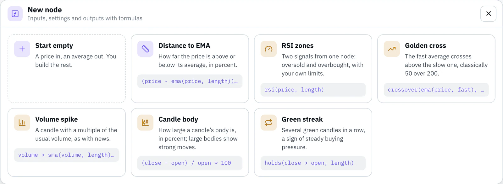

# Contributing a node

Thanks for sharing a node. This guide goes from the idea to the merged pull request. Auf Deutsch: [CONTRIBUTING.de.md](CONTRIBUTING.de.md)

## What makes a good node

- **One clear job:** a value or a signal you can't build as easily from the existing nodes, explained under `help` with an example.
- **Readable formulas:** good names for inputs and settings, earlier outputs reused instead of repeated.
- **Sensible settings:** every length has a minimum and a maximum; defaults that work on hourly candles.
- **Checked numbers:** tests with reference values you determined independently (below).
- **Both languages:** name and description in German and English. No German? Write English in both and say so in the pull request; we translate.

## Step by step

### 1. Build in the editor

Open the [editor](https://app.bellchain.app/), no account needed. In the nodes panel, under **Custom nodes**, click **New node**. Start from an example or empty. Errors show up right at the field, and the trial run computes every output over 500 hours of BTC/USDT.



### 2. Export

**Export** at the bottom left of the dialog saves the node as `<name>.bellchain-node.json`. The **JSON** tab shows the same text.

### 3. Fork and add the file

In the browser:

1. Click **Fork** at the top right of this page.
2. In your fork: **Add file** → **Upload files**, drop the file into `community/` and name it `community/<name>.json`: lowercase letters, digits and hyphens.
3. **Commit changes** on a new branch.

The `id` in the file is `custom.<name>`, for example `custom.hull-trend` in `community/hull-trend.json`.

With git:

```bash
git clone https://github.com/<your-name>/nodes
cd nodes
git switch -c hull-trend
cp ~/Downloads/hull-trend.bellchain-node.json community/hull-trend.json
```

### 4. Complete the file

| Field | Rule |
|---|---|
| `label`, `description` | In `de` and `en`. The description fits one line of the nodes panel, about 42 characters. |
| `help` | Recommended: what the node calculates, with an example. |
| `author` | Your name or GitHub name. |
| `tests` | At least one test; every output needs an expected value. |

### 5. Reference values

A test sets the settings, says what goes into the inputs and lists expected values at chosen candles. The check computes the node over the 500 hourly candles in `fixtures/btcusdt-1h-500.json` and compares, like the tests of Bellchain's own nodes. A test for [examples/abstand-zum-ema.json](examples/abstand-zum-ema.json), with every field written out:

```json
"tests": [
  {
    "name": "EMA 50",
    "settings": { "length": 50 },
    "inputs": { "price": "close" },
    "expectAt": { "48": { "out": null }, "250": { "out": 0.9740385803 } },
    "expectLast": { "out": -0.4179154069 }
  }
]
```

| Field | Meaning |
|---|---|
| `name` | Optional, shown in messages |
| `settings` | Values for this test; missing ones keep their default |
| `inputs` | A column of the prices (`open`, `high`, `low`, `close`, `volume`) or a formula from them, such as `close > open` for a signal input. Without it: the column with the input's name, otherwise `close` |
| `expectAt` | Expected values at candles 0 to 499; `-1` is the last candle |
| `expectLast` | Expected values at the last candle |
| `tolerance` | Allowed difference for numbers, default 0.000001; with values from a chart that shows two decimals, 0.01 or more |

Numbers are expected as numbers, signals as `true` or `false`, and `null` where there is no value yet (at the start, before a length is filled).

**Determine the values independently:** with a spreadsheet, a short script or another charting tool on the same candles. The file has the time of every candle (milliseconds since 1970, UTC). Values copied from Bellchain only prove that Bellchain computes like Bellchain. To compare, this prints what Bellchain computes at your test candles:

```bash
node scripts/check.mjs community/hull-trend.json --values
```

### 6. Check locally

You need [Node.js](https://nodejs.org/) 20 or newer, nothing else:

```bash
node scripts/check.mjs community/hull-trend.json
```

The check runs what the editor checks (names, types, formulas, limits), requires author, texts and tests, computes your tests and makes sure the node returns the same result on every run and never looks into the future. `--lang de` gives German messages. No Node.js at hand? Skip this step; the pull request runs the same check.

### 7. Open a pull request

In your fork: **Contribute** → **Open pull request**. Please change only files in `community/`.

### 8. The check on GitHub

GitHub Actions runs `node scripts/check.mjs` for every pull request. Problems appear as notes right in your file under **Files changed**. Push fixes to the same branch and the check runs again. For a first contribution, a maintainer may need to start the run.

### 9. Review

We read the formulas, recompute your reference values and check names and texts. Small fixes we may make ourselves; for bigger ones we'll ask. After the merge the node is in `community/`, ready for everyone to import.

## Improve a node

Change the file, raise `version` (for example 1.0.0 → 1.1.0) and open a pull request the same way. Chains that use the node keep their copy until their owners update it.

## Ideas and problems

A node you'd like? Open an issue: **Idea for a node**. Something computes oddly? **Problem with a node**. Questions about your account go to support@bellchain.app.

## How this repository is maintained

This repository is kept in sync with Bellchain's own repository. Nodes you contribute are taken over from here; everything else comes from there: the examples, the price data, `scripts/check.mjs`, the READMEs and the license. Pull requests that change those files are closed with a note.

## License

By opening a pull request you agree that your contribution is published under the [MIT License](LICENSE), like everything in this repository.
