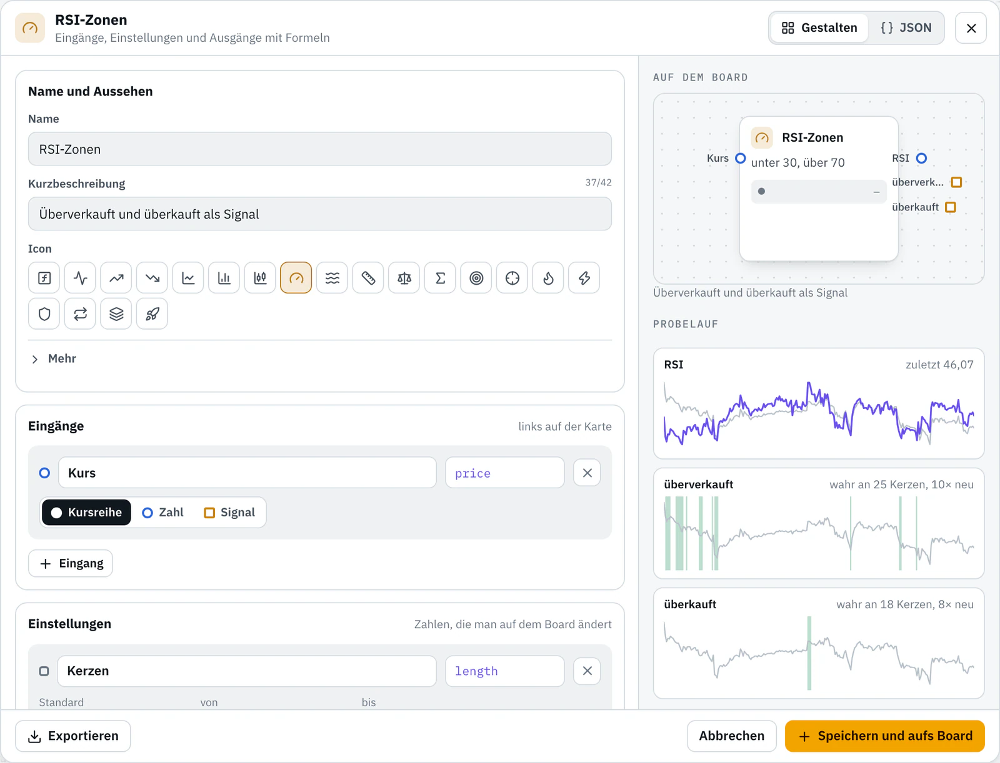
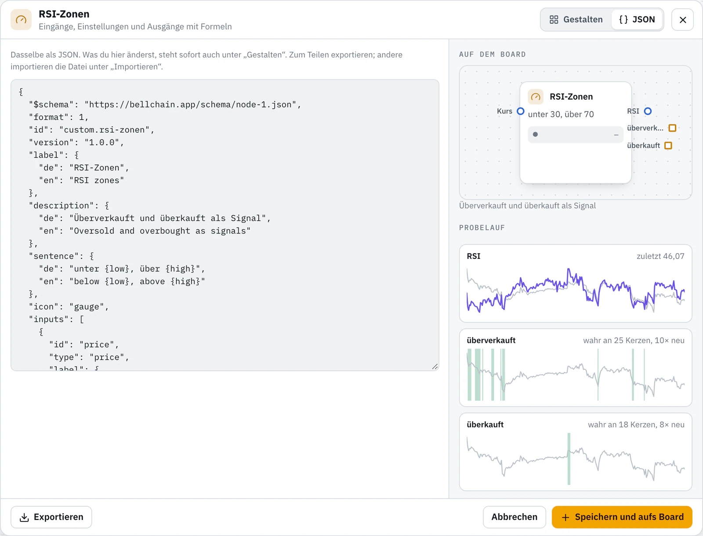

# Eigene Bausteine für Bellchain

Bausteine für [Bellchain](https://bellchain.app/de/), die du selbst baust: Eingänge, Einstellungen und Ausgänge mit Formeln statt Code. Jeder Baustein ist eine JSON-Datei. Importier ihn im Editor und nutz ihn wie jeden anderen Baustein: im Replay und live rechnet er gleich, nie mit Kursen aus der Zukunft.

In English: [README.md](README.md)

## Einen Baustein verwenden

1. Öffne eine Datei, etwa [examples/rsi-zonen.json](examples/rsi-zonen.json), und lade sie oben rechts mit **Download raw file** herunter.
2. Im [Editor](https://app.bellchain.app/): **Importieren** → **Datei wählen**. Der Baustein steht danach in der Bausteinleiste unter **Eigene Bausteine**.
3. Zieh ihn aufs Board und verbinde ihn.

Eigene Bausteine baust und testest du in jedem Plan; eine Chain mit eigenem Baustein aktivieren geht ab Pro.

## Was in diesem Repo liegt

| Pfad | Inhalt |
|---|---|
| `examples/` | Die Beispiele aus dem Editor (**Neuer Baustein**), mit Tests |
| `community/` | Bausteine aus der Community, einer je Datei |
| `fixtures/btcusdt-1h-500.json` | 500 Stundenkerzen BTC/USDT, die Kurse für die Tests |
| `scripts/check.mjs` | Die Prüfung, die bei jedem Pull Request läuft; Node.js 20 oder neuer, nichts zu installieren |
| `LICENSE` | MIT |

## Beispiele

<!-- examples -->
| Beispiel | Was es rechnet | Eingänge | Ausgänge |
|---|---|---|---|
| [Abstand zum EMA](examples/abstand-zum-ema.json) | Wie weit der Kurs über oder unter seinem Durchschnitt liegt, in Prozent. | Kurs (Kursreihe) | Abstand (Zahl) |
| [RSI-Zonen](examples/rsi-zonen.json) | Zwei Signale aus einem Baustein: überverkauft und überkauft, mit eigenen Grenzen. | Kurs (Kursreihe) | RSI (Zahl), überverkauft (Signal), überkauft (Signal) |
| [Golden Cross](examples/golden-cross.json) | Der schnelle Durchschnitt kreuzt den langsamen nach oben, klassisch 50 über 200. | Kurs (Kursreihe) | Kreuz (Signal) |
| [Volumen-Spitze](examples/volumen-spitze.json) | Eine Kerze mit einem Vielfachen des üblichen Volumens, etwa bei Nachrichten. | Volumen (Zahl) | Spitze (Signal) |
| [Kerzenkörper](examples/kerzenkoerper.json) | Wie groß der Körper einer Kerze ist, in Prozent; große Körper zeigen starke Bewegungen. | Eröffnung (Kursreihe), Schluss (Kursreihe) | Körper (Zahl), grün (Signal) |
| [Grüne Serie](examples/gruene-serie.json) | Mehrere grüne Kerzen in Folge, ein Zeichen für anhaltenden Kaufdruck. | Eröffnung (Kursreihe), Schluss (Kursreihe) | Serie (Signal) |
<!-- /examples -->

## Das Format

Ein Baustein ist JSON. Das Beispiel RSI-Zonen, gekürzt:

```json
{
  "id": "custom.rsi-zonen",
  "version": "1.0.0",
  "label": { "de": "RSI-Zonen", "en": "RSI zones" },
  "description": { "de": "Überverkauft und überkauft als Signal", "en": "Oversold and overbought as signals" },
  "inputs": [{ "id": "price", "type": "price", "label": { "de": "Kurs", "en": "Price" } }],
  "settings": [
    { "id": "length", "label": { "de": "Kerzen", "en": "Candles" }, "default": 14, "min": 2, "max": 100, "integer": true },
    { "id": "low", "label": { "de": "Unten", "en": "Low" }, "default": 30, "min": 0, "max": 100 }
  ],
  "outputs": [
    { "id": "value", "type": "number", "label": "RSI", "formula": "rsi(price, length)" },
    { "id": "oversold", "type": "signal", "label": { "de": "überverkauft", "en": "oversold" }, "formula": "value < low" }
  ],
  "tests": ["…"]
}
```

- **Eingänge** (bis 8) sitzen links auf der Karte: `price` (Kursreihe), `number` (Zahl) oder `signal` (wahr oder falsch).
- **Einstellungen** (bis 8) sind Zahlen, die man auf dem Board ändert.
- **Ausgänge** (1 bis 8) haben je eine Formel über Eingänge, Einstellungen und frühere Ausgänge.
- **Formeln** kennen Grundrechenarten, Vergleiche, `and`/`or`/`not`, `bedingung ? a : b`, `wert[n]` für frühere Kerzen und Funktionen wie `ema`, `rsi`, `atr`, `crossover`, `highest` und `holds`. Keine Schleifen, keine Uhrzeit, kein Netz.

Alle Felder und Funktionen: [Eigener Baustein](https://docs.bellchain.app/de/editor/custom-nodes/) und [Node-Spezifikation](https://docs.bellchain.app/de/developers/node-spec/) in der Doku.

## Einen Baustein beitragen

Du hast einen Baustein gebaut, der anderen helfen kann? Teil ihn hier. Wir sehen uns jeden Baustein an; geprüfte Bausteine bleiben in `community/`, für alle zum Importieren.

1. **Bauen** im Editor: Bausteinleiste → **Eigene Bausteine** → **Neuer Baustein**. Mit einem Beispiel anfangen oder leer; der Probelauf rechnet über 500 Stunden BTC/USDT.
2. **Exportieren:** **Exportieren** im Dialog speichert `<name>.bellchain-node.json`.
3. **Forken:** dieses Repo forken und die Datei als `community/<name>.json` anlegen. Die `id` ist `custom.<name>`.
4. **Ergänzen:** `author`, Name und Beschreibung auf Deutsch und Englisch und `tests` mit Referenzwerten (unten).
5. **Prüfen:** `node scripts/check.mjs community/<name>.json --lang de`. Die Prüfung rechnet deine Tests über die 500 Kerzen.
6. **Pull Request öffnen.** Dieselbe Prüfung läuft auf GitHub und markiert Probleme direkt in deiner Datei.
7. **Review:** Wir rechnen deine Werte nach und mergen den Baustein.



Schritt für Schritt mit allen Regeln: [CONTRIBUTING.de.md](CONTRIBUTING.de.md) · [Mitmachen](https://docs.bellchain.app/de/contribute/) in der Doku. Wünsche für Bausteine sind als [Issue](https://github.com/bellchain-app/nodes/issues/new/choose) willkommen.

## Referenzwerte

Jeder Baustein bringt Tests mit: Einstellungen, was an den Eingängen anliegt, und die erwarteten Werte an ausgewählten Kerzen. Die Prüfung rechnet den Baustein über die 500 Stundenkerzen in `fixtures/` und vergleicht, genau wie bei den Tests der offiziellen Bausteine.

```json
"tests": [
  {
    "name": "RSI 14, 30/70",
    "expectAt": { "51": { "value": 28.7846653502, "oversold": true } },
    "expectLast": { "value": 46.0677651404, "oversold": false }
  },
  {
    "name": "RSI 14, 40/60",
    "settings": { "low": 40 },
    "expectAt": { "45": { "oversold": true } }
  }
]
```

| Feld | Bedeutung |
|---|---|
| `name` | Optional, steht in den Meldungen |
| `settings` | Werte für diesen Test; fehlende behalten ihren Standard |
| `inputs` | Was an jedem Eingang anliegt: eine Spalte der Kurse (`open`, `high`, `low`, `close`, `volume`) oder eine Formel daraus, etwa `close > open` für ein Signal. Ohne Angabe die Spalte mit dem Namen des Eingangs, sonst `close` |
| `expectAt` | Erwartete Werte an den Kerzen 0 bis 499; negative Zahlen zählen vom Ende |
| `expectLast` | Erwartete Werte an der letzten Kerze |
| `tolerance` | Erlaubte Abweichung bei Zahlen, Standard 0.000001 |

Jeder Ausgang braucht mindestens einen erwarteten Wert. Bestimm die Werte unabhängig, mit einer Tabellenkalkulation, einem Skript oder einem anderen Chart-Programm, nicht durch Abschreiben aus Bellchain: Nur dann prüfen sie etwas. `node scripts/check.mjs --values` zeigt, was Bellchain rechnet, zum Vergleichen.

## Lizenz

MIT, siehe [LICENSE](LICENSE). Beiträge erscheinen unter derselben Lizenz.

Bellchain sendet Alarme. Es handelt nicht, verwahrt kein Geld und berät nicht zu Anlagen.
