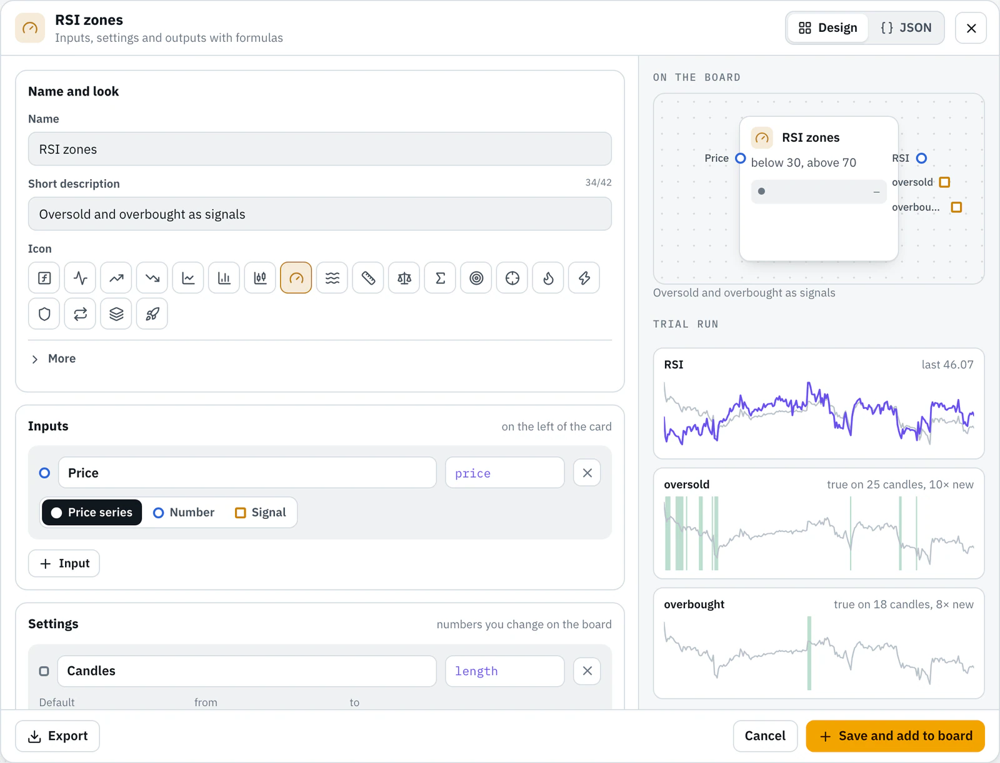
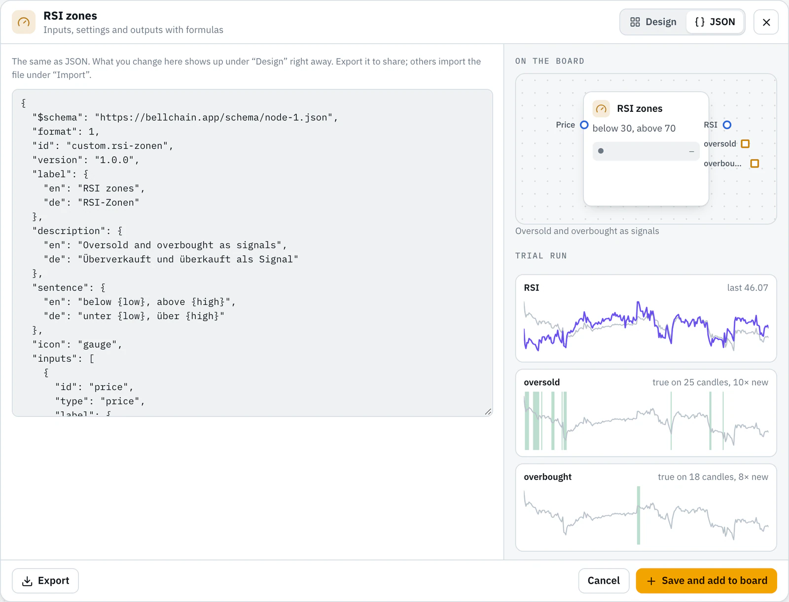

# Bellchain custom nodes

Nodes for [Bellchain](https://bellchain.app/en/) that you build yourself: inputs, settings and outputs with formulas instead of code. Each node is one JSON file. Import it in the editor and use it like any other node: in the replay and live it computes the same way, never with prices from the future.

Auf Deutsch: [README.de.md](README.de.md)

## Use a node

1. Open a file, for example [examples/rsi-zonen.json](examples/rsi-zonen.json), and download it with **Download raw file** at the top right.
2. In the [editor](https://app.bellchain.app/): **Import** → **Choose file**. The node appears in the nodes panel under **Custom nodes**.
3. Drag it onto the board and connect it.

Custom nodes can be built and tested on every plan; activating a chain that uses one needs Pro.

## What's in this repository

| Path | Content |
|---|---|
| `examples/` | The examples from the editor (**New node**), with tests |
| `community/` | Nodes from the community, one file each |
| `fixtures/btcusdt-1h-500.json` | 500 hourly candles of BTC/USDT, the prices the tests run on |
| `scripts/check.mjs` | The check that runs on every pull request; Node.js 20 or newer, nothing to install |
| `LICENSE` | MIT |

## Examples

<!-- examples -->
| Example | What it calculates | Inputs | Outputs |
|---|---|---|---|
| [Distance to EMA](examples/abstand-zum-ema.json) | How far the price is above or below its average, in percent. | Price (price) | Distance (number) |
| [RSI zones](examples/rsi-zonen.json) | Two signals from one node: oversold and overbought, with your own limits. | Price (price) | RSI (number), oversold (signal), overbought (signal) |
| [Golden cross](examples/golden-cross.json) | The fast average crosses above the slow one, classically 50 over 200. | Price (price) | Cross (signal) |
| [Volume spike](examples/volumen-spitze.json) | A candle with a multiple of the usual volume, as with news. | Volume (number) | Spike (signal) |
| [Candle body](examples/kerzenkoerper.json) | How large a candle’s body is, in percent; large bodies show strong moves. | Open (price), Close (price) | Body (number), green (signal) |
| [Green streak](examples/gruene-serie.json) | Several green candles in a row, a sign of steady buying pressure. | Open (price), Close (price) | Streak (signal) |
<!-- /examples -->

## The format

A node is JSON. The example RSI zones, shortened:

```json
{
  "id": "custom.rsi-zonen",
  "version": "1.0.0",
  "label": { "de": "RSI-Zonen", "en": "RSI zones" },
  "description": { "de": "Überverkauft und überkauft als Signal", "en": "Oversold and overbought as signals" },
  "inputs": [{ "id": "price", "type": "price", "label": { "de": "Kurs", "en": "Price" } }],
  "settings": [
    { "id": "length", "label": { "de": "Kerzen", "en": "Candles" }, "default": 14, "min": 2, "max": 100, "integer": true },
    { "id": "low", "label": { "de": "Unten", "en": "Low" }, "default": 30, "min": 0, "max": 100 }
  ],
  "outputs": [
    { "id": "value", "type": "number", "label": "RSI", "formula": "rsi(price, length)" },
    { "id": "oversold", "type": "signal", "label": { "de": "überverkauft", "en": "oversold" }, "formula": "value < low" }
  ],
  "tests": ["…"]
}
```

- **Inputs** (up to 8) sit on the left of the card: `price` (price series), `number` or `signal` (true or false).
- **Settings** (up to 8) are numbers you change on the board.
- **Outputs** (1 to 8) each have a formula over inputs, settings and earlier outputs.
- **Formulas** know arithmetic, comparisons, `and`/`or`/`not`, `condition ? a : b`, `value[n]` for earlier candles and functions such as `ema`, `rsi`, `atr`, `crossover`, `highest` and `holds`. No loops, no clock, no network.

All fields and functions: [Custom node](https://docs.bellchain.app/en/editor/custom-nodes/) and [Node specification](https://docs.bellchain.app/en/developers/node-spec/) in the docs.

## Contribute a node

Built a node others could use? Share it here. We review every node; checked nodes stay in `community/` for everyone to import.

1. **Build** it in the editor: nodes panel → **Custom nodes** → **New node**. Start from an example or empty; the trial run computes on 500 hours of BTC/USDT.
2. **Export** it: **Export** in the dialog saves `<name>.bellchain-node.json`.
3. **Fork** this repository and add the file as `community/<name>.json`. The `id` is `custom.<name>`.
4. **Complete** it: `author`, name and description in German and English, and `tests` with reference values (below).
5. **Check** it: `node scripts/check.mjs community/<name>.json`. It computes your tests over the 500 candles.
6. **Open a pull request.** The same check runs on GitHub and marks problems right in your file.
7. **Review:** we recompute your values and merge the node.



Step by step with all rules: [CONTRIBUTING.md](CONTRIBUTING.md) · [Contribute](https://docs.bellchain.app/en/contribute/) in the docs. Wishes for nodes are welcome as an [issue](https://github.com/bellchain-app/nodes/issues/new/choose).

## Reference values

Each node brings tests: settings, what goes into the inputs, and the expected values at chosen candles. The check computes the node over the 500 hourly candles in `fixtures/` and compares, just like the tests of Bellchain's own nodes.

```json
"tests": [
  {
    "name": "RSI 14, 30/70",
    "expectAt": { "51": { "value": 28.7846653502, "oversold": true } },
    "expectLast": { "value": 46.0677651404, "oversold": false }
  },
  {
    "name": "RSI 14, 40/60",
    "settings": { "low": 40 },
    "expectAt": { "45": { "oversold": true } }
  }
]
```

| Field | Meaning |
|---|---|
| `name` | Optional, shown in messages |
| `settings` | Values for this test; missing ones keep their default |
| `inputs` | What goes into each input: a column of the prices (`open`, `high`, `low`, `close`, `volume`) or a formula from them, such as `close > open` for a signal. Without it: the column with the input's name, otherwise `close` |
| `expectAt` | Expected values at candles 0 to 499; negative numbers count from the end |
| `expectLast` | Expected values at the last candle |
| `tolerance` | Allowed difference for numbers, default 0.000001 |

Every output needs at least one expected value. Determine the values independently, with a spreadsheet, a script or another charting tool, not by copying them from Bellchain: only then do they check anything. `node scripts/check.mjs --values` shows what Bellchain computes, for comparing.

## License

MIT, see [LICENSE](LICENSE). Contributions are published under the same license.

Bellchain sends alerts. It doesn't trade, hold funds or give investment advice.
